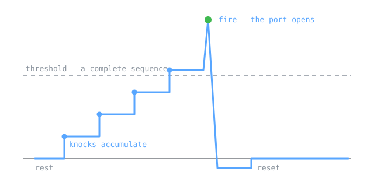

<p align="center">
  
</p>

# otkp — One Time Knock Protocol

**Nothing to scan. New knock, new port, every time. Replay futility. With Rust legitimacy.**

> **Status: alpha (v0.1.0).** Unaudited, not deployed, and the layered
> authorisation architecture in
> [`docs/DESIGN-air-gapped-authorization.md`](docs/DESIGN-air-gapped-authorization.md)
> is a *design*, not a running system — the daemon in `src/` implements one layer
> of it. Read §11 before trusting this with anything that matters.

---

## The same thing, said three ways

This project is documented at two altitudes throughout — every non-obvious line in
the source carries an `EXPERT:` note and a `KID:` analogy. The front page gets the
same treatment, because the fastest way to find out whether you understand
something is to try to explain it to someone who does not.

### The teacher's explanation

`otkp` derives a one-time sequence of port numbers from a shared secret and the
clock — the same construction as TOTP, applied to ports instead of digits — and
opens exactly one port, for exactly one source address, for one short window.

The daemon's core is a **threshold accumulator**, and that is the whole design:

- Each observed knock adds to a per-address potential. A sequence that reaches its
  length fires: the port opens, and the state resets.
- Failures accumulate the same way against a second, higher threshold, which fires
  into a rate-limited ban rather than an instant one.
- The threshold is crossed by *accumulation*, never by a single packet — which is
  what makes a spoofed packet unable to ban an address it does not own.

Three separations do the security work, and collapsing any two is where this class
of system usually fails:

| Layer | Proves | Does not prove |
|---|---|---|
| **Concealment** (the knock) | The sender knows the subject's secret | That the subject is *permitted* |
| **Authorisation** (a signed attestation) | That access was agreed, and when | That this peer holds the key |
| **Authentication** (the service, or a VPN behind the knock) | That the peer *is* the subject | That the action is in scope |

Everything else — source-address binding, the security-level ratchet, the audit
stream, the design notes on air-gapped authorisation and a deception layer — is
elaboration on those three, each carrying its cost next to its benefit.

### The student's explanation

Imagine a door with no handle, no keyhole, and no sign. From outside, the wall is
just wall — a scanner walks past and sees nothing to try.

You know a secret knock. You tap it out on the wall, and the door appears.

The guard inside has a clipboard. Each tap adds a mark. Enough marks in the right
order and he unlocks the door — for *your* address only, for thirty seconds, and
then he locks it again. Tap wrong and he marks that down too; enough wrong taps
and he stops listening to you entirely for a while.

And he never shouts "wrong!" at the first mistake, because anyone could stand
outside your house and tap a wrong rhythm to get *you* thrown out. He counts, and
he waits, and he writes it down.

### The symbol

The mark above is not a mascot. It is a **leaky integrate-and-fire neuron** — the
canonical model in computational neuroscience, in which evidence accumulates,
leaks away, and fires a spike when it crosses a threshold.

That is also, exactly, the state machine in [`src/engine.rs`](src/engine.rs).
Each knock steps the potential up; a complete sequence is the threshold; crossing
it fires and the port opens; the state resets. The failure path is the same shape
against a higher threshold, which is why a single wrong knock cannot lock anyone
out.

Drawn as a diagram rather than a cartoon because the protocol *is* a threshold
accumulator, and a picture that says so is worth more than one that does not.


### Where the idea comes from

Two ideas that already protect you everywhere else, fused:

| Idea | What it normally protects | What `otkp` borrows |
|---|---|---|
| **One-Time Password** (HOTP/TOTP) | Your login — Google Authenticator, Authy, 1Password | A secret plus a clock yields a value that changes every 30 s and can never be reused |
| **Port knocking** (`knockd`) | A hidden SSH or backup port | A *sequence* of connection attempts a daemon watches for, and only then opens a firewall hole |

Instead of a six-digit number, `otkp` derives a **one-time sequence of port
numbers** *and* the **one-time destination port** that sequence unlocks. Nothing
is open by default: there is no listening service to scan and no password to
brute-force.

---

## 1. Why this exists (threat model)

| Threat | Normal firewall / SSH | With `otkp` |
|---|---|---|
| Port scan finds your SSH | Port shows `open` | No port is open; scanner sees nothing |
| Attacker brute-forces the login | Endless attempts allowed | They can't even reach the port |
| Someone replays yesterday's knock | n/a | Sequences are time-based and single-use; yesterday's is dead |
| Someone shoulder-surfs one sequence | n/a | That sequence is already burned; the next one is unrelated |
| Attacker probes many ports looking for the "knock door" | n/a | First wrong knock → IP is banned |
| You want to reach a service from a café | Open port to the world | Port opens only for *your* IP, only for 30 s |

**Non-goals / honest limitations** are listed in [§8](#8-security-notes--limitations).
Read that section before trusting this with anything important.

---

## 2. The big picture (top-down)

Read this top to bottom — this is *top-down design*: the whole machine first,
the parts second, the lines of code last.

```
                    ┌──────────────────────────────────────────────────────┐
                    │  ONE SHARED SECRET PER USER (256 random bits)        │
                    │  given out once, out-of-band, at enrolment time      │
                    └───────────────┬──────────────────┬───────────────────┘
                                    │                  │
                 ┌──────────────────┴───┐          ┌───┴────────────────────┐
                 │  CLIENT              │          │  SERVER (otkp daemon)  │
                 │  `otkp knock`        │          │  `otkp serve`          │
                 └──────────────────────┘          └────────────────────────┘
                            │                                   │
   "What is the sequence   │                                   │  "What sequence
    for RIGHT NOW?"        │                                   │   SHOULD I see
                            ▼                                   ▼   right now?"
                 ┌──────────────────────┐          ┌──────────────────────────┐
                 │ HMAC-SHA256(secret,  │          │ HMAC-SHA256(secret,      │
                 │   user ∥ time_step)  │          │   user ∥ time_step)      │
                 └──────────┬───────────┘          └───────────┬──────────────┘
                            │                                  │
                            ▼                                  ▼
                 ┌──────────────────────┐          ┌──────────────────────────┐
                 │  KnockSpec           │          │  KnockSpec (recomputed   │
                 │   • ports: [a,b,c,d] │          │   for every user, every  │
                 │   • open_port: P     │          │   ±1 time step)          │
                 └──────────┬───────────┘          └───────────┬──────────────┘
                            │                                  │
        send a,b,c,d        │                                  │  watch every
        (in order, fast)    │                                  │  inbound packet
                            ▼                                  ▼
                 ┌────────────────────────────────────────────────────────────┐
                 │  THE WIRE                                                  │
                 │   client ──► knock a ──► knock b ──► knock c ──► knock d ──► │
                 └────────────────────────────┬───────────────────────────────┘
                                              │
                                              ▼
                 ┌────────────────────────────────────────────────────────────┐
                 │  STATE MACHINE (per source IP)                             │
                 │   matches a,b,c,d against every (user, time-step) candidate │
                 │   • all four in order  ──►  AUTHORISE  ──►  open port P     │
                 │   • any packet wrong   ──►  BAN the IP immediately          │
                 └────────────────────────────┬───────────────────────────────┘
                                              │
                                              ▼
                 ┌────────────────────────────────────────────────────────────┐
                 │  FIREWALL BACKEND (pluggable)                              │
                 │   iptables │ nftables │ custom command │ dry-run (log only) │
                 └────────────────────────────────────────────────────────────┘
```

### The four moving parts

1. **Secret** — 32 random bytes per user, created by `otkp enroll`, stored in the
   server's keyring and printed once as a base32 string for the user's client.
2. **Derivation** — `HMAC-SHA256(secret, "otkp-knock-v1" ‖ user_id ‖ time_step)`
   produces a 32-byte blob. From that blob we read out *how many* knocks, *which*
   ports, and *which* port to open. Deterministic, so client and server agree
   without talking.
3. **State machine** — the server watches inbound packets and keeps, per source
   IP, a scoreboard of "how far along is this IP in each possible sequence".
   Complete a sequence → open the port. Deviate → ban.
4. **Firewall backend** — the thing that actually opens/closes/blocks. It is a
   *trait* (an interface), so the daemon doesn't care whether it's talking to
   `iptables`, `nft`, a custom script, or a dry-run logger.

---

## 3. How a knock works, step by step

Say it's `2026-10-05T14:09:00Z`, so the Unix time is `1_759_678_140`.
With a 30-second step, the time step is `1_759_678_140 / 30 = 58_655_938`.

**On the client:**

```
$ otkp knock --server vps.example.com --port 62201 --user alice --secret JBSWY3DPEHPK3PXP...
[otkp] time step      : 58655938 (t+0s into the window)
[otkp] derived knocks : 41231, 58802, 19904, 33710
[otkp] will open port : 27488
[otkp] sending 4 knocks to vps.example.com:62201 ...
[otkp] done. You now have ~30s to connect to vps.example.com:27488
```

**On the server, `otkp serve` is doing this every time a packet arrives:**

1. Is the source IP already banned? → drop, say nothing.
2. Is it already authorised? → drop, say nothing.
3. For every enrolled user and every time step in `{now-1, now, now+1}`
   (the ±1 is clock-skew tolerance), recompute the expected sequence.
4. Does this packet's port match the *next expected* port of any candidate?
   - **Yes** → advance that candidate by one.
   - **No candidate matched** → that is a *failed knock*: increment the IP's
     failure count and, at the threshold (default **1**), ban it.
5. If a candidate reaches the end of its sequence → open `open_port` for that IP
   for `open_ttl_seconds`, and log it.

Then a sweeper thread closes the port again when the window expires.

---

## 4. Build & install

Requires a Rust toolchain (`rustup`, stable ≥ 1.74).

```bash
git clone <this repo> otkp && cd otkp
cargo build --release
# the binary lands at ./target/release/otkp
```

Run the test suite (unit + integration + protocol vectors):

```bash
cargo test
```

---

## 5. Quick start

### 5.1 On the server — create the config and the first user

```bash
sudo ./target/release/otkp init --dir /etc/otkp
sudo ./target/release/otkp enroll --dir /etc/otkp --user alice
```

`enroll` prints (once!) something like:

```
============================================================
  Enrolment created for user 'alice'
============================================================
  Secret (base32) : JBSWY3DPEHPK3PXPJBSWY3DPEHPK3PXPJBSWY3DPEHPK3PXP
  Current HOTP    : 492051   (for reference only — not used to knock)
  Knock listener  : 0.0.0.0:62201
  Enrolment URI   : otkp://alice?secret=JBSWY...&server=vps.example.com:62201&step=30
============================================================
  Give this to alice ONCE, over a channel you trust.
  The server keeps only its own copy in keyring.json.
============================================================
```

### 5.2 On the server — start the daemon

```bash
# Safe first run: log what WOULD happen, touch no firewall rules.
sudo ./target/release/otkp serve --dir /etc/otkp --firewall dry-run

# Real run with iptables:
sudo ./target/release/otkp serve --dir /etc/otkp --firewall iptables
```

### 5.3 On the client — knock, then connect

```bash
otkp knock --server vps.example.com --port 62201 \
           --user alice --secret JBSWY3DPEHPK3PXP...
# then, within the window:
ssh -p 27488 alice@vps.example.com
```

### 5.4 Sanity-check the derivation without touching the network

```bash
# On the server, see exactly what alice's sequence is right now:
sudo otkp verify --dir /etc/otkp --user alice
```

---

## 6. Command reference

| Command | Where | What it does |
|---|---|---|
| `otkp init --dir DIR` | server | Writes `config.json`, empty `keyring.json`, empty `banlist.json` |
| `otkp enroll --dir DIR --user NAME` | server | Creates a per-user secret and prints the one-time enrolment URI |
| `otkp serve --dir DIR` | server | Runs the daemon: listens for knocks, opens/closes ports, bans failures |
| `otkp verify --dir DIR --user NAME` | server | Prints the current (and neighbouring) knock sequence, for debugging |
| `otkp knock --server H --port P --user U --secret S` | client | Derives the sequence for *now* and sends it |
| `otkp help` | both | Usage |

Useful flags:

| Flag | Applies to | Meaning |
|---|---|---|
| `--firewall dry-run\|iptables\|nftables\|command` | `serve` | Which backend to drive |
| `--source udp\|raw` | `serve` | How knocks are observed (see §7) |
| `--step-offset -1\|0\|1` | `knock` | Try the previous/next time step if your clock is off |
| `--mode udp\|raw` | `knock` | How knocks are *sent* (must match the server's `--source`) |
| `--bind-ip ADDR` | `knock` | The address the server will observe, when the server binds to source IP (needed behind NAT) |
| `--ban-fail-threshold N` | `serve` | Failures **inside the rolling window** before a ban (default `5`) |
| `--ban-window SECS` | `serve` | Length of the rolling failure window (default `3600`) |
| `--security-level 0\|1\|2` | `serve` | Which rung of the security ladder to run on (default `0`) |
| `--audit-log PATH` | `serve` | Where the structured audit stream is written (level 2) |
| `--open-ttl SECS` | `serve` | How long an opened port stays open |
| `--ban-ttl SECS` | `serve` | `0` = permanent ban |

---

### 6.1 Security levels — the ratchet

`otkp` is built to be *climbed*, not configured. **Level 0 is the default because
it works anywhere and delivers the largest gain for the least effort**; each rung
above adds one named assurance at one named cost. You climb when your threat model
or your regulator tells you to — never because the documentation shamed you into
it. A tool whose default is hard to deploy gets deployed at zero, or not at all.

| Level | Name | Buys | Costs |
|---|---|---|---|
| 0 | `basic` *(default)* | Nothing to scan; failed knocks are rate-limited, not one-strike banned | None — works behind NAT and on mobile clients |
| 1 | `replay-resistant` | A captured sequence is replayable only from the same address — closes replay **and** the active race | Breaks NAT and mobility: clients must be told the egress address (`--bind-ip`) |
| 2 | `auditable` | A machine-readable record of every authorisation, ban and expiry | An audit file to manage, rotate and protect |

```bash
sudo otkp serve --dir /etc/otkp --security-level 2 --firewall iptables
```

**Raising the level turns on what it requires.** `--security-level 1` sets
`bind_to_source_ip`; `--security-level 2` defaults the audit path into the data
directory. The reverse is enforced too: a config that *claims* level 1 while
running level 0 is **refused at startup**, because a security claim the tool does
not enforce is worse than no claim at all. Lowering is never automatic — declaring
a lower level does not switch off a setting you enabled by hand.

At every startup the daemon prints the rung you are on, what it buys, what it
costs, and what the next rung would buy.

#### The audit stream (level 2)

JSON Lines — one object per line, append-only, created `0600`:

```json
{"event":"authorised","v":1,"at":1791234567,"ip":"203.0.113.9","port":60802,"user":"alice","time_step":59707818,"expires_at":1791234597}
{"event":"port_closed","v":1,"at":1791234597,"ip":"203.0.113.9","port":60802,"user":"alice"}
```

JSON Lines rather than a JSON array because appending a line is a single small
`write`, which the kernel makes atomic, while appending to an array requires
rewriting the closing bracket — neither atomic nor crash-safe. A log that corrupts
on a crash fails exactly when it matters. Every record carries `v` (the format
version), so a consumer can parse what it understands and skip what it does not
rather than breaking on the first new field.

Human log prose and machine records are deliberately separate: the wording of the
human log can change without breaking anything downstream.

**One deliberate exception to the project's fail-closed rule:** if the audit write
fails, the daemon logs it loudly and *continues*. Losing a record is bad; taking
down access control because a disk filled is worse, and would deny service to
legitimate users *and* stop recording. A deployment with a regulatory obligation
to never lose a record should call `AuditLog::write` directly and treat the error
as fatal — the API allows that; the daemon does not choose it.

#### Levels 3 and above — designed, not built

The ladder is meant to continue, but only as far as an operator's threat model and
budget justify. The rungs above 2 are designed in
[`docs/DESIGN-air-gapped-authorization.md`](docs/DESIGN-air-gapped-authorization.md)
and are deliberately **not implemented** — shipping a level that does not deliver
its assurance would be exactly the kind of claim this project refuses to make.

| Level | Name | Would buy | Would cost | Status |
|---|---|---|---|---|
| 3 | `layered` | A second factor behind the knock (VPN handshake or signed token), so a knock-secret compromise exposes a port but does not grant access | A second component to run, key and monitor; a tunnel-aware session lifetime instead of a fixed TTL | Designed |
| 4 | `attested` | Pre-committed, multi-party attestations on a shared ledger: access is permitted only once several parties have agreed it *and* the ledger confirms | A consortium, an air-gapped root CA with threshold signing, a participation agreement, and named liability | Designed |

Two things worth saying plainly about level 4, because it is the rung people
reach for first and should not:

- **It is not primarily an engineering step.** It needs a consortium to exist —
  governance, membership, liability, dispute resolution — and no code bootstraps
  one. The technical design is the easy half.
- **It only pays for itself if several mutually distrusting parties must *agree*,
  not merely verify.** A single writer needs a signed record and a transparency
  log, not consensus. See the design note §5.3 for the deciding question.

The ordering principle is unchanged from levels 0–2: each rung names an assurance
and its cost, and an operator climbs only when their threat model or their
regulator says so.

---

## 7. Two ways to watch for knocks (`--source`)

The classic `knockd` design sniffs raw packets, because the whole point is that
the knocked-on ports are **closed** — nothing is listening. That needs
`CAP_NET_RAW`/root, so `otkp` offers both:

| `--source` | How it works | Needs root? | Use it for |
|---|---|---|---|
| `raw` | `AF_PACKET` socket captures every IPv4 packet and reads the destination port out of the TCP/UDP header. True port knocking: knock any closed port. | yes | Production |
| `udp` | A single UDP socket listens on `listen_addr`; the client sends tiny datagrams whose payload carries the intended port number. | no | Development, tests, containers, CI |

Both feed the **exact same** state machine and derivation code — only the
`KnockSource` implementation differs. That is the point of programming against a
trait: the interesting logic is written once and tested once.

---

## 8. Security notes & limitations

**What it gets right**

- The secret never crosses the wire. Only *derived* values do.
- Nothing listens on the protected port until an authorised knock completes, so
  there is nothing for a scanner to find.
- A new knock **and** a new destination port are derived every 30-second window.
- **Sequences are single-use.** Once a sequence has authorised anyone it is dead
  for the rest of its window; a captured sequence replayed afterwards matches
  nothing, and the replayer is rate-limited like any other prober.
- Secrets are compared in constant time (`MasterSecret::ct_eq`, wired into
  `PartialEq`) and zeroised on drop.
- `unsafe` is denied crate-wide and opted into in exactly two modules — the
  raw-packet sniffer and the signal handler. Six blocks, six `// SAFETY:`
  comments, no pointer arithmetic, no `unsafe fn`.
- An off-path attacker cannot ban an arbitrary address with a single spoofed
  packet: the ban is a rolling-window rate limit, not a one-strike rule.

**What you must know before trusting it**

- **A replay gains reachability, not access — and reachability is the thing the
  layer exists to deny.** The knock does not authorise; it opens a keyhole, and
  the service behind it still authenticates. So an attacker who wins a race gets
  an open port and *no credential* — and against a VPN or a key-authenticated
  service, an open port with no key is worth nothing (WireGuard drops
  unauthenticated packets regardless). But concealment is exactly what this layer
  is for, and against a service with an exploitable surface, 30 seconds of
  reachability is the whole ballgame. Which of those applies to you is why
  binding is a rung you can climb to rather than a default.

- **Source-IP binding is off by default.** Turn it on (`"bind_to_source_ip": true`)
  and a captured sequence matches only from the *same address*, which closes the
  race as well as the replay: an attacker's address derives a different
  expectation and matches nothing. The cost is that it breaks NAT and mobility —
  the client must be told the egress address the server will see
  (`otkp knock --bind-ip ...`). The daemon logs a warning at startup when binding
  is off, so this is not a silent default.

- **The two replay defences are complements, not alternatives.** The *burn*
  (on by default) makes a sequence single-use and leaves the derivation alone, so
  you can knock from anywhere — the roaming-friendly half. *Binding* additionally
  closes the race. With the burn on and binding off, an attacker who captured a
  sequence must win a race to use it; with both on, there is no race to win.

- **A race is futile *and* loud, and that is the point.** The attacker has only two
  moves and both are bad for them:

  | Move | Outcome |
  |---|---|
  | Replay *after* the legitimate knock | Burned. Matches nothing, the replayer accumulates failures and is banned, and the legitimate user is unaffected. **Zero gain.** |
  | Race — inject first, drop the legitimate packets | The attacker's address is authorised, and the legitimate user's own packets then match nothing, so *their* address accumulates failures and is banned. The attacker gains a port and **no credential**. |

  So the only winning move requires breaking the legitimate user's knock, and that
  break is visible. The signature is *the same user authorised from two addresses
  in one window* — the alert in §10. A passive attacker who captures and waits
  gets nothing; an active one reveals themselves. The race is not a hole in the
  design, it is a **tripwire**.

  - **The cost, stated plainly:** the race locks the legitimate user out for
    `ban_ttl_seconds` (default one hour). That is a self-inflicted denial of
    service, bounded but real, and it is the price of the detection.
  - **And detection is only worth having if someone is watching.** The daemon logs
    enough to derive the signature — an authorisation from an unexpected address,
    plus a different address accumulating failures for the same user in the same
    window — but it does **not** emit that as an alert. That is a roadmap item,
    not a feature.
- **The ban is a rolling-window rate limit** (default: 5 failures per IP per
  hour), not a one-strike rule. Earlier versions banned on the first failure,
  which let an off-path attacker ban an arbitrary address with a single spoofed
  packet — a denial of service against any address they chose. Requiring N
  failures inside a rolling window raises that cost from one packet to N packets
  per window per victim.
  - **The residual is not eliminated.** N packets per hour per victim is still
    cheap for a determined attacker with a fast link. The remaining fix is to
    only count a failure once the source has made some correct progress, or once
    a MAC-valid attempt has failed (see §10). Until then, treat a ban as a
    rate-limit signal, not as proof of an attacker.
  - The window is *rolling*, not a fixed bucket, so bursts cannot be timed around
    a reset.
- **The client and server clocks must agree** to within ±1 time step. Use NTP.
- **The knock sequence is low-entropy.** Ports are drawn from the configured
  range, so an attacker who can observe the wire can replay *within the same
  time step*. Mitigation: don't knock over a channel an attacker can sniff, and
  keep the time step short. A future version will add an HMAC-carrying knock
  payload for `udp` mode (see roadmap).
- **The protected service must be bound to the opened port and must still
  authenticate you itself.** `otkp` is a *second* lock, not a replacement for
  SSH keys or application auth.
- **This is v0.1.0.** It has not been audited. Do not put it in front of anything
  whose loss would ruin your week.

---

## 9. Architecture (top-down module map)

A Cargo **workspace** with two crates. They share a convention — JSON Lines, a
`v` field, an `event` tag — so the two event streams can be correlated
downstream. They share **no code**, and neither depends on the other. That
separation is a security property, not packaging: the bait must not live in the
component that authenticates users.

```
src/                      otkp — concealment and authentication
├── main.rs          ← the thinnest possible shell: parse argv, call the CLI
├── lib.rs           ← the library's front door: declares modules, re-exports
├── error.rs         ← OtkpError + Result<T> alias (one error type for the lib)
├── logging.rs       ← a tiny dependency-free timestamped logger
├── secret.rs        ← MasterSecret (zeroising 32 bytes) + base32/hex codecs
├── config.rs        ← ServerConfig / ClientConfig / FirewallConfig / SecurityLevel
├── keyring.rs       ← Enrollment + Keyring: who is allowed, and their secrets
├── crypto.rs        ← HMAC-SHA256, HOTP (the OTP heritage), and KnockSpec
├── engine.rs        ← the state machine: observe(packet) → Outcome  ★ the core
├── auth.rs          ← who currently has an open port, and until when
├── banlist.rs       ← banned IPs, optionally persistent, optionally expiring
├── audit.rs         ← the structured event stream (security level 2)
├── firewall.rs      ← `trait Firewall` + iptables/nftables/command/dry-run
├── net.rs           ← `trait KnockSource` + UDP listener + AF_PACKET sniffer
├── daemon.rs        ← wires a KnockSource to the Engine, plus the sweeper
└── cli/
    ├── mod.rs       ← argument parsing (no external crate) + dispatch
    ├── init.rs      ← `otkp init`
    ├── enroll.rs    ← `otkp enroll`
    ├── knock.rs     ← `otkp knock`   (the client)
    ├── serve.rs     ← `otkp serve`   (the daemon launcher)
    └── verify.rs    ← `otkp verify`  (debug: print the current sequence)

decoy/                    otkp-decoy — the deception layer (rung 1)
├── main.rs          ← the decoy daemon; observes and records, never acts
├── lib.rs           ← front door
├── error.rs         ← the crate's own error type (not shared, deliberately)
├── banner.rs        ← the decoy catalogue: name, port, inert banner string
├── trip.rs          ← classify() → Trip → Response  ★ the design
├── audit.rs         ← the structured trip stream (same convention, own code)
└── listener.rs      ← the TCP listener that serves banners and never reacts
```

**Design style used throughout**

- **Top-down.** Every file opens with a `//!` module doc that says *what this
  part is for* in plain language, then drills into details. `main.rs` is the
  highest level; `crypto.rs` is the lowest.
- **Object-oriented, the Rust way.** Data + behaviour live together in `struct`s
  with `impl` blocks; fields are private and reached through methods
  (encapsulation). Variation is expressed with **traits** (`Firewall`,
  `KnockSource`, `Clock`) instead of class hierarchies (polymorphism).
  Composition beats inheritance: `Engine` *has a* `Keyring`, *has a* `Firewall`.
- **Commentary for two audiences.** Nearly every item carries an `EXPERT:` note
  and a `KID:` analogy. That is not decoration — writing the kid version is how
  you discover you didn't actually understand the expert version.
- **Constraints in the type system where possible.** `decoy::Response` has no
  variant carrying an `IpAddr`, so the code path that could revoke the wrong
  thing does not exist. `SecurityLevel` asserts what the config must deliver, and
  `validate` refuses a config that claims more than it does.

---

## 10. Roadmap

Ordered by what actually closes the largest security gap first, not by what is
easiest. Items marked **[planned path]** are the agreed design direction; the
reasoning for each is recorded so a future reader does not have to re-derive it.

### Related design notes

- [`docs/DESIGN-air-gapped-authorization.md`](docs/DESIGN-air-gapped-authorization.md)
  — authorising access with an air-gapped signing key, and why that component is
  deliberately *separate* from this daemon (its key must be offline; the knock
  secret must be online). Includes the confused-deputy requirement, the
  cache-vs-dependency question a ledger-based authorisation has to answer, when a
  permissioned ledger is genuinely the right choice (several mutually distrusting
  parties must *agree*, not merely verify), and what an air gap does not protect
  against.
- [`docs/DESIGN-deception-layer.md`](docs/DESIGN-deception-layer.md) — attracting
  automated attackers into wasting resources on decoys, and detecting intrusion
  by **negative space**: a decoy has no legitimate use, so any interaction with
  it is signal, whether or not the attacker sees through the pretence.
  - **Rung 1 of this is implemented**, as a separate crate: `decoy/`, built by
    `cargo build --workspace`, binary `otkp-decoy`. It is deliberately not part
    of the `otkp` daemon — the bait must not live in the component that
    authenticates users.
  - It observes and records. It cannot revoke, block or retaliate, by
    construction: every response is credential-scoped and there is no API that
    names an address.
  - Rungs 2–4 (graduated enforcement, tarpits, synthetic-data fountains) are
    designed and not built.

### Security gaps, in priority order

- [x] **Replaced the hard ban with a rolling-window rate limit.** Done in
  `ban_fail_threshold` + `ban_window_seconds` (default 5 failures per IP per
  hour). `ban_threshold = 1` used to let an off-path attacker ban an arbitrary
  address with a single spoofed packet; that now costs N packets per window per
  victim.
  - **Residual, not yet closed:** N packets per hour is still cheap for a
    determined attacker. Close it by only counting a failure once the source has
    made some correct progress, or once a MAC-valid attempt has failed. The
    rolling window raises the cost; it does not remove the attack.
- [x] **Bind the sequence to the source address.** Done, behind
  `bind_to_source_ip` (default **off**). The address is appended to the HMAC input
  under a distinct protocol label (`otkp-knock-v1-ipbind`), so a sequence captured
  on the wire matches only when replayed from the same address — defeating both
  passive replay and the active race. The client takes `--bind-ip` for NAT.
  - Why off by default: it breaks NAT and mobility, so it must be a deliberate
    choice. The daemon warns at startup when it is off.
  - Popeea et al. (2011) list client IP as a sequence input, so this is a correct,
    known fix rather than a new idea — recorded so the claim is not overclaimed.
  - **Residual:** with binding *off*, replay from another address still succeeds
    within the window. Binding on closes it; the burn (below) narrows the window
    in which a race is possible but does not remove the race by itself.
- [x] **Single-use sequences — the "burn".** Implemented as
  `single_use_sequences` (default **on**). Once a sequence has authorised
  anyone, it is dead for the rest of its window; a replay matches nothing, falls
  into the ordinary failure path, and the replayer is rate-limited like any other
  prober. Purely server-side: no protocol, client or payload change.
  - **This is the roaming-friendly replay defence.** Because it does not touch
    the derivation, a client may knock from any address. The first use consumes
    the sequence, so a copy of it is worthless wherever it is replayed from.
    Verified live: a sequence used from `127.0.0.1` and replayed identically from
    `127.0.0.2` was rejected as burned and the replayer was banned.
  - **The burn key follows the binding mode**, and that direction is
    load-bearing: `(user, window)` when unbound, `(user, window, address)` when
    bound. Keying per-address while *unbound* gives no replay protection at all,
    because the attacker replays from their own address and finds an unburned
    entry.
  - Cost, documented rather than hidden: with binding **off**, the burn permits
    one knock per window per user, so a second device in the same window looks
    exactly like a replay — because it is one. With binding **on**, each address
    has its own sequence and multi-device works.
  - A rollback after a failed firewall call *un-burns*, or the user would be
    locked out for the rest of the window by a transient failure.
  - Keying the burn per `(user, step, src_ip)` is a trap: it gives *no* replay
    protection, because an attacker replaying from their own address finds an
    unburned entry. Burn per `(user, step)` and bind to `src_ip` in the
    derivation instead — then per-IP burns are safe, because each address has its
    own sequence anyway and multi-device keeps working.
  - Costs, all real: in-memory state that a restart forgets; a rollback on
    firewall failure must *un*-burn or the user is locked out for the window; and
    one knock per window per user unless combined with the `src_ip` binding.
  - Note what it does *not* buy: an on-path attacker can inject or drop packets
    and win the race. The burn narrows replay to "attacker must beat Alice",
    which is a real narrowing but not replay resistance. The `src_ip` binding is
    what removes the race.
- [ ] **HMAC-authenticated knock payload (high).** `AF_PACKET`
  captures the whole frame including the UDP payload, so a `raw`-mode knock *can*
  carry a MAC. (An earlier note in this file wrongly claimed headers-only; the
  limitation is a definitional one inherited from `knockd`, not a technical one.
  This is precisely why fwknop left header-based knocking behind and invented
  SPA.) Payload: `HMAC(secret, user ‖ step ‖ src_ip ‖ nonce) ‖ nonce`. The
  `src_ip` binding means a replay from another address fails the MAC outright.
  Cost: per-user anti-replay memory that must survive restarts, or it desyncs.
- [ ] **Detection: three alerts (medium).** With the burn and the authorising-IP
  log in place, the daemon becomes a *sensor*, which is arguably its most
  valuable property — it is the only component that can tell you an on-path
  adversary exists.
  1. Burned sequence reused → an on-path observer is present.
  2. Same user authorised from two IPs in one window → relay or key compromise.
  3. Authorised IP outside the user's known set → key compromise or stolen
     credential.
  - **A replayed sequence is NOT evidence of key compromise.** An observer
    captures ports, not the key; HMAC is one-way, so they cannot compute the next
    window. Key compromise shows up as *fresh* sequences from an unexpected IP,
    never as a replay. Do not rotate the key in response to alert 1 — that leaves
    the actual problem (someone reading your traffic) untouched.
- [ ] **Correlate with the service's own logs (medium).** "Port opened" plus
  "service authentication failed from that same IP" is a strong forged-knock
  signal. The daemon cannot see this alone — it opens a hole and its knowledge
  ends there — so it needs the two log sources joined outside the daemon.
- [ ] **Known edge case: an open IP is exempt from the rate limiter (low).**
  `Engine::observe` returns early for an IP that already has a port open, and
  that return happens *before* failure counting. So for the duration of its
  window, an authorised IP can send unlimited knock-range packets that match
  nothing without accumulating a single failure.
  - **Not exploitable.** Reaching the open state requires a valid knock first, so
    this only applies to an IP that has already authenticated. The worst case is
    an authenticated user who is also probing, and their traffic is already
    attributable.
  - **It is a deliberate trade, not an oversight.** The same early return is what
    stops a just-authorised user being banned by stray knock-range traffic —
    without it, the daemon could ban the very user it just let in. Protecting the
    legitimate case is worth the coverage gap.
  - Recorded so it is known rather than discovered. A future version could count
    failures for open IPs but hold them below the threshold, or apply a separate
    higher limit.
- [ ] **Per-device keys with an enrolment registry (medium).** Today a key is
  per-user, so "Alice's key" cannot be told apart from "Alice's key copied to
  another machine". One key per *registered device* turns that into an anomaly
  you can detect ("known key, unknown context"), which is the cheapest real
  improvement to the attribution story in §11.2. Small change to the keyring
  model: the enrolment key becomes `(user, device_id)`.
- [ ] **Attribution events as a documented interface (medium).** §11.2 argues that
  the value of this design is that every action traces to a named credential. That
  is only true if the events are *exportable* — a stable, documented record of
  `{user, credential/device, src_ip, time_step, outcome}` that a UEBA or SIEM can
  consume. Right now the information exists in log lines; it should exist as a
  structured stream. This is what makes the "tell the user they were compromised"
  story implementable rather than aspirational.

### Features and packaging

- [ ] **Tunnel-aware grant lifetime (high, blocks the VPN deployment).** A fixed
  30 s `open_ttl_seconds` kills a WireGuard tunnel at its first rekey (~120 s).
  The grant must instead be held open *while the tunnel is alive* and released
  when it dies. Needs a peer-state probe (`wg show` output or netlink) — a new,
  small dependency, and the first real code for the VPN path.
- [ ] **Idle / timed / held session teardown (agreed).** When a tunnel is up, the
  operator chooses one of three policies: drop after N minutes of inactivity,
  drop on a fixed timer regardless of activity, or leave the port up for the
  session. All three are policy over the same tunnel-state signal, so they share
  the probe above. Recorded because the third is deliberately *not* the default:
  "leave it up" means the port is open until something else closes it, which is
  a normal VPN with extra steps, and the operator should have to choose it.
- [ ] **Drop the per-session derived VPN port.** Decided against: a 16-bit port
  number is recovered by a scanner in about a second, so it is obscurity rather
  than a control; it fights how VPNs work (WireGuard has one listen port per
  interface, shared by all peers, so per-user ports would need one interface per
  user); and it would force otkp to reconfigure the VPN daemon on every session.
  Use a fixed non-default port and let the source-IP scoping be the control.
- [ ] **Write up the VPN deployment (README §12).** knock → tunnel → services,
  with the tunnel-lifetime problem and the random-port reasoning recorded, and
  the "opened but no tunnel ever" forged-knock alert.
- [ ] Multi-port open (open a *set* of services per user).
- [ ] Key rotation and per-user revocation with a generation counter. (Bounds the
  blast radius of a leaked key and enables revocation. Note it does **not** help
  with replay: a replay happens inside one rotation period exactly as it happens
  inside one time step.)
- [ ] `--source raw` support for IPv6.
- [ ] Prometheus metrics endpoint (loopback-only).
- [ ] systemd unit + `CAP_NET_RAW`/`CAP_NET_ADMIN` drop-in hardening.
- [ ] Fuzzing (`cargo-fuzz`) on `parse_ipv4_dest_port` and the payload codec, plus
  a MIRI run over the test suite to check the `unsafe` in `net.rs`.
- [ ] Formal verification: the engine is already a pure function, so Kani could
  prove authorisation soundness, ban-policy safety and bounded state.

### Documentation

- [ ] An honest comparison against fwknop/SPA, including when *not* to use OTKP.
  A portfolio artifact that knows its own replacement reads as senior.

---

## 11. What this does and does not protect against

Stated plainly, because a security tool that oversells itself is worse than one
that is merely weak.

**It does:** hide the protected service from scanners (no port answers), make a
captured knock a short-lived one-shot credential rather than a permanent one, and
give you a sensor for on-path observers.

**It does not:** stop a determined on-path attacker from racing a replay (until
the `src_ip` binding lands), replace the protected service's own authentication,
or protect you if the secret leaks *and* the attacker is at a network position
you trust.

**It is not a substitute for the service's authentication.** The knock opens a
door; the service still asks for ID. That layering is the point — a knock-secret
compromise is survivable precisely because sshd (or whatever is behind the port)
asks for something the attacker does not have.

### 11.1 On "AI can hack anything"

This gets asked a lot, so it is worth an explicit answer. The short version: AI
does not change the mathematics, and it does not change what an attacker needs.
It changes the *cost* of finding and chaining mistakes, which is a real shift but
a different one from "everything is now hackable".

What actually protects a system, and where OTKP sits:

| Attack | Does OTKP help? | Why |
|---|---|---|
| Automated scanning for open ports | **Yes, fully** | There is nothing to find. No port answers, so there is nothing to fingerprint or to match against a CVE database. This is the single biggest win and it is not a small one. |
| Automated exploitation of a known CVE in the protected service | **Yes, while the knock is intact** | The attacker cannot reach the service to send the exploit. This is the "concealment defeats the reconnaissance phase" argument, and it is the strongest reason to run something like this. |
| AI-assisted source review of *your* code | **No** | An LLM reading this repo will find real issues faster than a human will. That is an argument for keeping the code small, auditable and honest about its gaps — which is what §10 and this section are for. |
| Phishing or social-engineering the secret | **No** | The secret is the whole boundary, and it lives on a client. AI makes convincing phishing cheaper. This is the most likely real-world failure, and no amount of knock cleverness fixes it. |
| An on-path attacker who can read your traffic | **Partially** | They can race a replay until the `src_ip` binding lands. They cannot derive future sequences (HMAC is one-way), so their capability is bounded to one window, one shot. |
| Compromised client with a valid key | **No** | A machine that holds the key *is* an authorised user as far as the protocol can tell. |
| Supply-chain compromise in a dependency | **No** | Out of scope. Mitigated only by keeping the dependency list short (see `Cargo.toml`). |

The honest summary: **OTKP removes the entire opportunistic tier** — the scanners,
the mass CVE exploitation, the bots — and does essentially nothing against a
targeted attacker who can phish you, sit on your network, or own your laptop.

That is worth having. Removing the opportunistic tier is what most real-world
"we got breached" stories are made of. But it is not the same as being unhackable,
and any system that claims to be is one you should trust less, not more.

**Specifically on agentic and AI-driven attackers.** This gets asserted about
designs like this one, and the honest version is narrower than it sounds.

An AI agent is better than a human at exactly the things that dominate real-world
intrusion: enumerating attack surface at scale, matching findings against known
vulnerabilities, and generating plausible social engineering. It is not better at
breaking cryptography, and it does not change what an attacker *needs*.

That gives a clean split:

- **Against the automated tier — scanning, mass exploitation, credential stuffing
  — this design removes the target rather than defending it.** There is no port to
  enumerate, so there is nothing for an agent to find, fingerprint, or match
  against a CVE database. An agent that is a thousand times faster finds nothing a
  thousand times faster. This is where the design is genuinely effective, and it
  is the tier that fills incident reports.
- **Against the targeted tier, AI changes nothing structural.** An agent does not
  defeat a 256-bit key, an air gap, or a signature. It does make two things
  cheaper: reviewing this codebase for implementation bugs, and crafting social
  engineering convincing enough to talk a user through the residual attack in the
  design note. Both of those cut *against* the design, not for it.

So the defensible claim is: **this design is not more vulnerable to AI attackers,
and it is substantially more resistant to the automated tier that AI makes cheap.**

Not "infinitely harder". Not "unhackable". Security claims are statements about
cost, and a claim of impossibility is one a reviewer can falsify with a single
counterexample — which makes overclaiming not just dishonest but *ineffective*,
because the audience most worth convincing is the one that will check.

### 11.2 Attribution: whose credential, and why that is not the same as who

This section exists because the design gives you something genuinely rare, and it
is easy to overclaim what that thing is. The distinction matters.

**What you get, with certainty.** Because the knock binds to a per-user secret and
the tunnel binds to a per-user key, every action traces to a *specific credential*.
Not an IP, not a shared service account, not "someone on the VPN" — a named
credential. Most systems cannot do this at all. It is the precondition for every
question below, and it is worth stating plainly as the design's strongest
non-obvious property.

**What you do not get: victim versus perpetrator.** A key is a *bearer*
credential. It proves whoever holds it, and nothing about who that is:

| Who is acting | Evidence presented |
|---|---|
| Alice at her desk | Alice's key |
| Mallory who phished Alice's key | Alice's key |
| Malware on Alice's laptop | Alice's key |
| Alice, gone rogue | Alice's key |

All four are byte-identical. The key does not know who is holding it, so no amount
of protocol design can separate them. Keep three levels apart:

```
1. Whose credential?          cryptographic    certain
2. Was it used anomalously?   behavioural      probable
3. Victim or perpetrator?     motivational     inferred, least reliable
```

OTKP delivers level 1. Level 3 is the insider-threat problem, and it is genuinely
unsolved: the discriminator is motive, and motive is not observable. An entire
product category (UEBA) exists to produce *risk scores* for it, not verdicts.

**Where the signal actually lives — behaviour, not crypto.** The two cases tend to
have different shapes:

- **Compromise** shows *context* anomalies: familiar behaviour, unfamiliar context.
  New country, 3am, a new device, a sudden burst after months of silence.
- **Insider** shows *scope* anomalies: familiar context, out-of-scope behaviour.
  Usual IP, usual hours, usual device — but touching data they have never touched,
  probing systems outside their remit, slow exfiltration shaped like normal traffic.

So the signal exists, but it is a heuristic with both false positives and false
negatives. A careful attacker mimics normal behaviour; a careless insider trips
context alarms.

**Levers, if you want to push on level 3:**

1. **Per-device keys with an enrolment registry.** Not one key per user — one per
   *registered device*. A copied key then shows up as "known key, unknown context",
   and "why is Alice's laptop key active from two continents?" becomes answerable.
   The cheapest real improvement, and a small change to the keyring model.
2. **Step-up authentication on sensitive actions.** If the attacker holds only the
   VPN key, step-up fails — a compromise signal. If the insider holds everything,
   it succeeds — no help. Separates *stolen key* from *full credentials*, not
   *victim* from *insider*.
3. **Behavioural baselining (UEBA).** The real answer, and it is a separate system,
   not a feature of the knock. It consumes the attributed events this daemon emits,
   plus the VPN's, plus the service logs, and produces risk scores.

All three are *additional software*, consistent with the architecture in §12: otkp
emits attributed events; a separate component reasons about them. Do not put the
reasoning inside the daemon.

**The claim to make, and the one to avoid.**

Avoid: *"we know whether the user was hacked or turned against us."* That
overclaims, and a security interviewer will take it apart in about thirty seconds.

Make: *"we can attribute every action to a specific user credential with certainty
— which most designs cannot — and that attribution is the precondition for any
compromise-versus-insider analysis. The classification itself needs behavioural
analytics on top, and even then it is a probability, not a verdict."*

That version is true, specific, and demonstrably your own design decision.

**Why the attribution is still worth having, on its own.** Even without any
classification, knowing *which credential* was used is most of the operational
value. The two consequences that follow are real and are not hypothetical:

- **You can tell a user they have been compromised.** When a knock or a tunnel
  authenticates with Alice's credential from somewhere Alice has never been, that
  is a fact you can act on and a warning you can give. For most organisations the
  common case is not an insider; it is a leaked or stolen credential, and this is
  exactly the case the attribution catches.
- **It changes the attacker's calculus.** An attacker who knows that every action
  is bound to a named credential, and that the victim will be told, has a much
  worse position than one operating behind a shared account or a raw IP. That is a
  real deterrent effect, and it is a legitimate thing to say out loud.

What it is not: a guarantee that the attacker stops, or a way to tell a determined
insider from a victim. Attribution raises the cost and enables the warning. It does
not adjudicate motive.

---

## License

**MIT.** See [`LICENSE-MIT`](LICENSE-MIT).

(The Rust convention is dual `MIT OR Apache-2.0`, which is what this project
declared until an audit noticed that only the MIT text was actually present. The
declaration now matches the file.)
